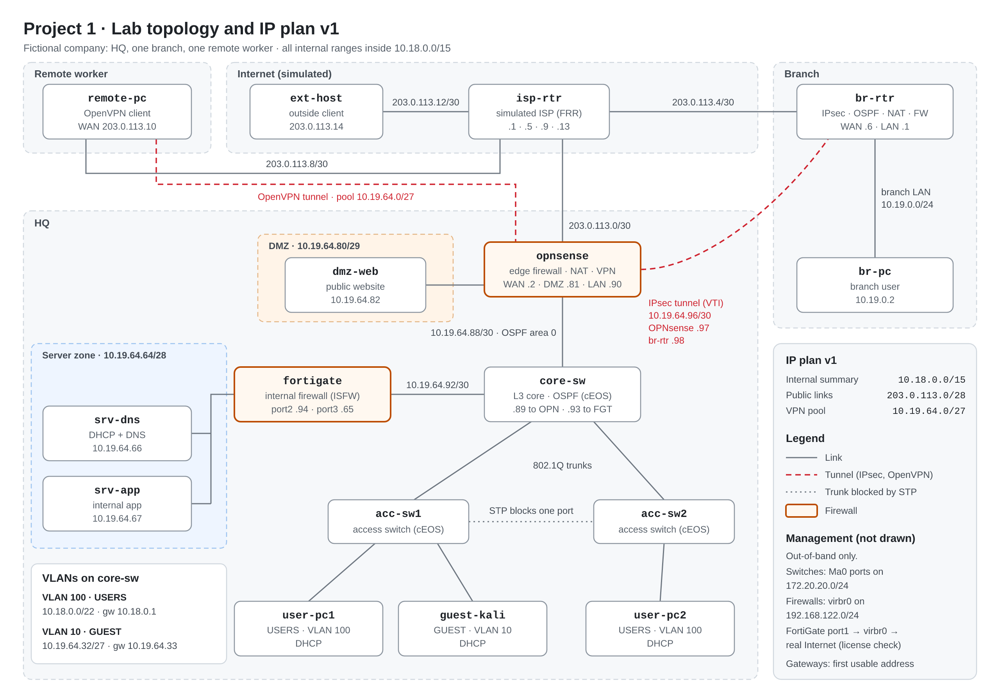

# Project 1: High-Level Design (HLD)

Status: v1 draft, 19 Nov 2026. See also: [IP addressing plan](ip-plan.md).

## 1. Purpose and scope

This project builds the network of a fictional company with three sites: a headquarters (HQ), one branch office and remote workers.

Version 1 covers:

- Switching and routing at HQ: VLANs, 802.1Q trunks, STP, routing between VLANs, DHCP relay and OSPF.
- Firewalls in layers: OPNsense at the edge with a DMZ, a FortiGate inside HQ in front of the servers, and an ACL on the core switch.
- VPNs: a site-to-site IPsec tunnel to the branch, and OpenVPN for remote workers.
- Automation: acceptance tests, configuration backups and compliance checks run by scripts.

Not in version 1:

- Wi-Fi, because access points and wireless clients can't be emulated in this lab. Planned for v2.
- IDS/IPS, because it doesn't fit v1's time budget. Planned for v2 (Suricata on OPNsense).
- Cloud, because the project focuses on an on-premises company network.

## 2. Assumptions and constraints

Company assumptions (the subnets are sized for the planned numbers):

| Item | Now | Planned |
| --- | --- | --- |
| HQ employees | 300 | 750 |
| Branch employees | 50 | 150 |
| Printers (rule: one per 25 employees) | 12 at HQ, 2 at the branch | 30 at HQ, 6 at the branch |
| GUEST devices (visitors only) | – | 20 at the same time |
| Internal servers | 2 | 10 |
| DMZ servers | 1 | 4 |
| Remote workers at the same time | – | 24 |

Lab constraints:

| Constraint | Limit | What it changed in the design |
| --- | --- | --- |
| Laptop RAM | 16 GB in total, about 9.5 to 12 GB free for the lab | The full lab is planned at 8 to 9 GB. Each zone gets one or two test hosts, not its real number of devices. |
| FortiGate trial: interfaces | 3 | The FortiGate protects one zone only, the servers: port1 for management and Internet, port2 to core-sw, port3 to the servers. |
| FortiGate trial: policies | 3 | One policy for users, branch and VPN users to the servers, one for DHCP relay, one spare. |
| FortiGate trial: routes | 3 | One summary route covers every internal range (10.18.0.0/15); the second route is the default. |
| FortiGate trial: VPN | Weak encryption only (DES), no SSL VPN | Both VPNs run on OPNsense (and br-rtr), not on the FortiGate. |
| FortiGate trial: license check | Needs contact with Fortinet every hour; after 30 days without it, all traffic is dropped | The FortiGate's default route goes through port1 to the real Internet. |
| FortiGate trial: tied to one VM | A rebuilt VM loses the trial | The FortiGate runs as a permanent VM, outside containerlab, and is never redeployed. |

## 3. Topology and zones

HQ connects to the Internet through OPNsense, the edge firewall. The branch reaches HQ through a site-to-site IPsec tunnel between br-rtr and OPNsense, and remote workers connect through OpenVPN to OPNsense. Inside HQ, core-sw routes between the VLANs, and the FortiGate stands between core-sw and the server zone.

| Zone | What's in it | Who may reach it | Protected by |
| --- | --- | --- | --- |
| Internet | isp-rtr, ext-host (an outside client) | Every internal zone, through NAT | Nothing (untrusted) |
| DMZ | dmz-web, the public website (room for 4 public servers) | The Internet on web ports only, and internal users | OPNsense. The DMZ can't open connections into the LAN. |
| USERS | Employees' computers and printers (VLAN 100) | Nobody from the Internet or GUEST | OPNsense at the edge, the guest ACL on core-sw |
| GUEST | Visitors' devices (VLAN 10) | Nobody. GUEST may only go out to the Internet and use DNS on OPNsense. | The guest ACL on core-sw, OPNsense |
| Server zone | srv-dns (DHCP and DNS), srv-app (internal app) | USERS, the branch and VPN users, on DNS and the app port only | The FortiGate, and OPNsense at the edge |
| Branch LAN | Branch computers and printers (br-pc in the lab) | Nobody from the Internet (only replies get in) | br-rtr's firewall, OPNsense's IPsec rules |
| VPN users | Remote workers, with addresses from the VPN pool | Nobody. They may reach the server zone only. | OPNsense's OpenVPN rules, the FortiGate |
| Management | The switches' Ma0 ports, the firewalls' admin ports | Only the admin, from the laptop | Out-of-band networks that no test host is connected to |

## 4. Addressing

All internal ranges sit inside one summary, 10.18.0.0/15, because the FortiGate trial allows only three routes, so one route must cover everything internal. One summary also keeps the rules short: one "internal networks" object in the firewalls, and one line in the guest ACL.

The addresses use 10.x and not 172.x or 192.168.x, because Docker's default address pools (172.17.0.0 to 172.31.255.255, and 192.168.0.0/16) would put new Docker networks on top of the lab's ranges.

VLAN IDs: USERS = 100, GUEST = 10.

The public ISP links use 203.0.113.0/24 (RFC 5737), because these documentation addresses never appear on the real Internet, so the lab never borrows a real company's addresses.

The full plan, with every subnet and the reason for its size, is in [ip-plan.md](ip-plan.md).

## 5. Routing

| Device | How it routes | What it learns or sends | Why |
| --- | --- | --- | --- |
| core-sw | OSPF and static | Learns the default route, the DMZ, the VPN pool and the branch LAN from OPNsense. Has a static route to the server zone through the FortiGate, and announces it into OSPF. | It's the gateway for USERS and GUEST, and the junction between the edge and the FortiGate. |
| OPNsense | OSPF and static | Sends a default route into OSPF. Learns HQ ranges from core-sw, and the branch LAN from br-rtr over the tunnel. Its own default route points to isp-rtr. | It's the edge: HQ's only way out to the Internet. |
| FortiGate | Static only | 10.18.0.0/15 through core-sw, and a default route through port1. | The trial allows 3 routes, and the license check needs the Internet. |
| br-rtr | OSPF and static | Announces only the branch LAN over the tunnel. Learns HQ ranges from OPNsense. Its default route, typed by hand, points to isp-rtr. | Local breakout: the branch's Internet traffic leaves through its own WAN. |
| isp-rtr | Connected links only | Knows only its four public /30 links. | A real ISP never learns a customer's private ranges, so traffic must be NATed or sent through a tunnel. |

The FortiGate has only two routes: 10.18.0.0/15 through core-sw, and a default route through port1. The second one is needed because the trial license is checked with Fortinet every hour over the Internet. After 30 days without contact, the FortiGate drops all traffic.

core-sw reaches the server zone through the FortiGate (port2), and it puts that route into OSPF so that OPNsense, and through it the branch and the VPN users, learn the way to the servers.

br-rtr announces only the branch LAN into OSPF, because otherwise OPNsense would learn a route to br-rtr's WAN address through the tunnel. It would then send the tunnel's own outer packets into the tunnel (recursive routing), and the tunnel would break.

## 6. Security

Security layers:

| Layer | Device | Allows | Blocks |
| --- | --- | --- | --- |
| Edge firewall | OPNsense | The LAN to the Internet (with NAT). The Internet to the DMZ on web ports only (inbound NAT). Branch and VPN users to the server zone. | Everything else from the Internet. The DMZ to the LAN. Branch and VPN users to GUEST. |
| Internal segmentation | FortiGate | USERS, branch and VPN users to the servers, on DNS and the app port only. DHCP relay from core-sw. | Every other flow to the servers (implicit deny), and it logs them. |
| Guest ACL | core-sw, on the GUEST gateway | DNS to OPNsense, and the Internet | Every internal range (10.18.0.0/15) |
| Branch firewall | br-rtr | The branch LAN to the Internet (with NAT), and the replies | New connections from the Internet into the branch |
| Device hardening | Switches and firewalls | Admin access over SSH, from the management network only | Telnet and web admin, and admin access from test hosts. NTP, logging and a login banner are also set. |

Key traffic flows (from the test matrix):

| From | To | Allowed or denied | Enforced by |
| --- | --- | --- | --- |
| USERS | srv-app (app port) | Allowed | FortiGate policy 1 |
| GUEST | USERS and the server zone | Denied | core-sw guest ACL, FortiGate |
| br-pc (branch) | srv-app | Allowed | OPNsense IPsec rules, FortiGate policy 1 |
| remote-pc (VPN) | srv-app | Allowed | OPNsense OpenVPN rules, FortiGate policy 1 |
| ext-host (Internet) | dmz-web (web) | Allowed | OPNsense inbound NAT and WAN rule |
| dmz-web | The LAN | Denied | OPNsense DMZ rules |

## 7. VPNs

| Item | Site-to-site | Remote access |
| --- | --- | --- |
| Between | OPNsense (HQ) and br-rtr (branch) | remote-pc and OPNsense |
| Technology | Route-based IPsec, with a tunnel interface (VTI) | OpenVPN (TLS, an SSL VPN) |
| Encryption and authentication | IKEv2 for the key exchange, AES-GCM for encryption | TLS with certificates from OPNsense's own certificate authority; one client certificate for remote-pc |
| Inside addresses (tunnel /30 or pool) | Tunnel 10.19.64.96/30 (OPNsense .97, br-rtr .98) | Pool 10.19.64.0/27 |
| What traffic uses it | Branch traffic for HQ only. OSPF runs over it. | The remote worker's traffic to HQ |
| What its users may reach | The server zone (DNS and the app), never GUEST | The server zone (DNS and the app) only |

Only HQ-bound branch traffic uses the IPsec tunnel. The branch's Internet traffic goes out br-rtr's own WAN, with its own NAT (local breakout), because it's simpler and the branch keeps Internet access if the tunnel is down.

## 8. Management and lab platform

Management is out-of-band only. The switches are managed through their Ma0 ports, on containerlab's management network (172.20.20.0/24). The firewalls are managed through virbr0 (192.168.122.0/24), libvirt's network on the laptop.

The test hosts have no management interface, because a management network bypasses every firewall. A test host with one could reach other zones around the firewalls, and the tests would prove nothing. All tests run on the data plane.

| Component | Runs as | How many |
| --- | --- | --- |
| Switches | Arista cEOS containers, in containerlab | 3 (core-sw, acc-sw1, acc-sw2) |
| Linux hosts and routers | Containers, in containerlab | 11 (isp-rtr, ext-host, remote-pc, dmz-web, srv-dns, srv-app, user-pc1, user-pc2, guest-kali, br-rtr, br-pc) |
| OPNsense | Virtual machine (libvirt/KVM) | 1 |
| FortiGate | Virtual machine (libvirt/KVM), permanent | 1 |
| Host bridges | Linux bridges on the laptop, created by `bridges-up.sh`. They connect the two VMs to the containers. | 5 (br-wan, br-lan, br-dmz, br-fgt, br-srv) |

The full lab needs about 8 to 9 GB of RAM, out of the laptop's 16 GB.

## 9. Key decisions and risks

Key decisions:

| Decision | Why |
| --- | --- |
| The FortiGate is an internal firewall in front of the servers, not the edge firewall | The trial's limits (3 interfaces, weak VPN only) fit an internal role. OPNsense handles the edge, NAT and the VPNs. |
| Branch Internet: local breakout | Simpler, the branch keeps Internet if the tunnel is down, and Phase 3 stays smaller. Trade-off: OPNsense doesn't see the branch's Internet traffic. |
| Management is out-of-band only | Test hosts can't get around the firewalls through a management network. |
| One summary, 10.18.0.0/15 | One FortiGate route covers every internal range, and it stays outside Docker's address pools. |
| The FortiGate runs as a permanent VM, outside containerlab | The trial license is tied to one VM, and a redeploy would lose it. |
| Switches on Arista cEOS in containerlab | Free, light on RAM, a command line close to Cisco IOS, and the lab is defined as code. |

Risks:

| Risk | Mitigation |
| --- | --- |
| The FortiGate trial stops working without hourly contact with Fortinet | Default route through port1 to the real Internet; the license status is in the health checks |
| Running out of RAM (8 to 9 GB planned, out of 16 GB) | Firefox closed for full-lab sessions; RAM measured in Phase 1; a swap file as a safety net |
| OPNsense doesn't inspect the branch's Internet traffic (local breakout) | A stateful firewall and NAT on br-rtr, and its rules in the acceptance tests |
| Recursive routing if br-rtr announces its WAN link over the tunnel | br-rtr announces only the branch LAN, and the health checks verify it |
